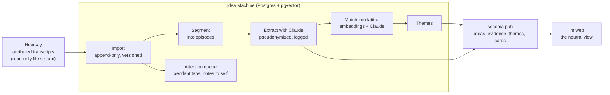

  <picture>
    <source media="(prefers-color-scheme: dark)" srcset="docs/assets/ideamachine-mark-dark.svg">
    
  </picture>

# Idea Machine

Turns transcripts of my recorded conversations into a searchable map of the ideas in them.

Idea Machine reads the speaker-attributed transcripts that [Hearsay](https://github.com/lowmagic/hearsay)
makes from conversations recorded with consent. It groups them into episodes, has Claude pull out ideas,
jokes, tasks and decisions with quotes and line citations, and links each idea to similar ones it has seen
before. A web view (`im web`) shows the result. Most recorded speech is small talk, so most of the work is
deciding what deserves attention, and measuring whether a cheap model can decide that before trusting it to.

> **Versions.** `v1` is the proof of concept as it ran, before the V2 refactor. To run it, check out `v1.1`:
> V1 plus one fix, so naming a speaker no longer sends an unchanged transcript back to Claude
> ([#10](https://github.com/lowmagic/ideamachine/pull/10)). `main` is moving to V2
> ([decision 0005](docs/decisions/0005-presentation-inside-idea-machine.md)).

## The interesting parts

- **Everything derived can be rebuilt.** Episodes are content-addressed (`uuid5` of the heuristic version and
  input hash), so a transcript correction re-derives only the episodes it touches. Every derived row records
  the code, model and prompt version that produced it, and `im reset --stage X` drops a stage to rebuild.
  My verdicts and the attention queue are anchored to transcript segments, not episodes, so they survive
  re-segmentation. When Hearsay forgets a span, the episodes, captured ideas and verdicts built from it are deleted
  here too.
- **What leaves the box is a versioned policy.** Speakers are pseudonymized per request (`me`, `S1`, `S2`),
  and the mapping stays local. Every Claude request is logged with the segment IDs it carried, its tokens
  and cost, and a monthly budget is checked before each one.
- **A plain data contract on both sides.** Idea Machine reads Hearsay's file stream read-only, and the web view
  reads only the views in schema `pub`, as its own role, so each side can change without touching the other's
  internals.

## Stack

Python 3.13, uv, Postgres 16 + pgvector, Claude (Anthropic SDK), sentence-transformers, Docker on TrueNAS.

## Running it

Setup, commands and configuration: [docs/install.md](docs/install.md). Deploying to the NAS:
[docs/deploy.md](docs/deploy.md).

## Status

Single-user; runs on a home NAS whenever Hearsay's stream has new turns, from its NVMe pool; 89 tests (pytest, against a throwaway Postgres); V2 in
[docs/SPEC.md](docs/SPEC.md) and [docs/ROADMAP-v2.md](docs/ROADMAP-v2.md) (V1's in [docs/ROADMAP.md](docs/ROADMAP.md)).
